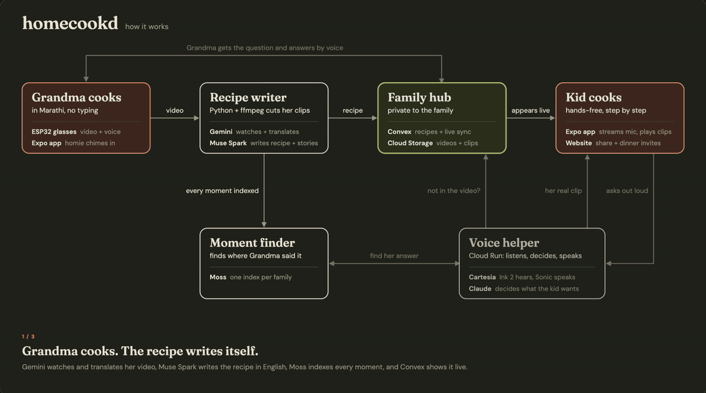

<div align="center">

# homecookd

**An older family member cooks once. The next generation cooks it anywhere, hearing their real voice.**

A family recipe app that keeps the person in the recipe and keeps the family talking.

<a href="https://youtu.be/8Ibl2QnL9dw"></a>

<a href="https://youtu.be/8Ibl2QnL9dw"></a>

<sub>Click the thumbnail or badge to watch the full demo video on YouTube</sub>

</div>

## What is homecookd?

**1. Recipes that keep the person.**
Family recipes were never written down. They live in the hands and voices of our older family members.
homecookd turns one cooking video into a step-by-step recipe, and every step plays the cook's own clip.

**2. Connection across distance and language.**
The family cook can record in their ethnic language without typing, and a younger family member follows along in
English. When they get stuck, the question goes back to the cook, so the recipe starts a conversation.

**3. Hands-free, voice-first.**
The kid's hands are covered in flour, so they cook by talking to **homie**, a voice guide that reads
steps, sets timers and plays the family cook's clip of that moment.

## How it works

<p align="center">
  
</p>

1. **The family cook records. The recipe writes itself.** Gemini watches and translates the video, Muse Spark
   writes the recipe in English, Moss indexes every moment, and Convex shows it to the family live.
2. **The kid asks. The family cook answers.** Cartesia Ink 2 hears the question, Claude decides what to do, and
   Moss finds the moment the cook explained it. homie plays their real clip.
3. **Not in the video? Ask the cook.** homie never makes up an answer. Convex sends the question to the
   cook, Cartesia transcribes their voice reply, and it shows up for the kid live.

## Overview

| Folder | What's in it |
| --- | --- |
| [`app/`](app/) | Expo / React Native iPhone app: the family cook records, the kid cooks by voice |
| [`voice/`](voice/) | Live voice service (homie) on Cloud Run: Cartesia Ink 2 + Sonic, Claude |
| [`convex/`](convex/) | Backend: families, recipes, questions, voice notes, live sync, Moss search |
| [`pipeline/`](pipeline/) | Python + ffmpeg video worker: cuts clips, runs Gemini and Muse Spark, publishes |
| [`glasses/`](glasses/), [`edible-glasses/`](edible-glasses/) | ESP32-S3 smart glasses and the VM that turns their stream into video |
| [`web/`](web/) | Next.js site on Vercel: landing page, recipe share pages, invites |
| [`cloud/`](cloud/) | Upload signer and Google Cloud setup scripts |

**Built with:** Cartesia (Ink 2, Sonic) · Claude · Gemini · Muse Spark (Meta) · Moss · Convex · Expo ·
Google Cloud · Vercel · ESP32-S3

## Voice with Cartesia

Voice is how both people use homecookd: the kid's hands are busy, and many older family members would
rather talk than type, often not in English.

- **Ink 2 (live speech-to-text):** hears the kid while cooking, with built-in turn detection.
- **Ink (batch):** transcribes the family cook's voice-note answers.
- **Sonic 3.6 (text-to-speech):** homie's voice, streamed to the phone, with mood and speed set per line.
- **Localized voice:** homie speaks multiple languages in one voice.

First audio from Sonic arrives in about 120–250 ms.

## Gemini model pathways

Gemini is the part of homecookd that watches the family cook's video. To get there we tested several
Gemini models on real cooking footage and compared them on **time**, **cost** and **accuracy**. We finalized
on **Gemini 3.8 Flash** (`gemini-3.8-flash`).

### Where Gemini runs

| Job | Model | Where |
| --- | --- | --- |
| Watch the video: steps, timestamps, ingredients, the cook's words | `gemini-3.8-flash` (final) | [`pipeline/process.py`](pipeline/process.py) |
| Put out-of-order clips back in order (one small text-only call) | `gemini-3.8-flash` | [`pipeline/order.py`](pipeline/order.py) |
| Check each recipe against frames from the video | `gemini-3.8-flash` | [`pipeline/evaluate.py`](pipeline/evaluate.py) |
| Translate the cook's voice-note answers (e.g. Marathi to English) | `gemini-3.8-flash` | [`convex/lib/translate.ts`](convex/lib/translate.ts) |
| Live listening for languages Ink 2 doesn't cover (Marathi) | `gemini-3.5-transcribe-live` | [`voice/src/geminiLive.ts`](voice/src/geminiLive.ts) |
| homie's backup voice when Sonic fails | `gemini-3.8-flash-tts` | [`voice/src/geminiTts.ts`](voice/src/geminiTts.ts) |

### What we compared (real API calls, same clips)

| | Gemini 3.1 Pro (preview) | Gemini 3.8 Flash |
| --- | --- | --- |
| Price per 1M tokens (in / out) | $2.00 / $12.00 | $0.75 / $3.75 |
| Extract + merge, same 2 clips | ~$0.20 (90 s clip alone: $0.08, 33 s) | **$0.047** for all 3 calls |
| Projected 3-hour recording | ~$3.60 – $6.30 | ~$1.30 – $2.40 |
| Speed | 15-min files could take 3+ min each | Noticeably faster; Batch API run of 2 clips done in ~3 min at half price |
| Accuracy | Most consistent step count run to run | Good recipes; step count varied slightly between runs (8 vs 9), fixed with schema checks and a retry |

Full numbers: [docs/COSTS.md](docs/COSTS.md).

### What worked

- **Gemini 3.8 Flash for video.** About 4× cheaper than Pro with recipe quality close enough that the cost and
  speed won out, so a family can turn hours of cooking into a recipe on a small budget.
- **A tiny AI copy of the video.** 360p, 1 fps, mono audio. Gemini samples video at 1 fps anyway, so uploads are
  ~50× smaller with nothing lost.
- **`MEDIA_RESOLUTION_LOW` pinned.** 5,460 tokens per minute of video vs 17,340 on HIGH (3.2× fewer).
- **15-minute files.** Every call stays under 200k tokens (the cheaper price tier), files run in parallel, and one
  failure never sinks the whole recipe.
- **Structured output + validation.** Gemini returns JSON checked against a Pydantic schema
  ([`pipeline/schema.py`](pipeline/schema.py)), with one retry, which evened out Flash's run-to-run variation.
- **Text-only merge and ordering.** The video is sent once; later steps work from Gemini's text.

### What didn't

- **One long call for a full recording.** A 3-hour video is ~1.0–1.1M tokens: at the input limit and billed at
  the higher > 200k rate.
- **Pro for everything.** Most accurate, but slow on long files and too expensive for our $20 budget.
- **HIGH media resolution.** 3.2× the tokens with no visible gain for cooking steps.
- **Gemini Live for every language.** It hears Marathi better than the alternatives, but it's slower than Ink 2,
  so we only use it where Ink 2 doesn't cover the language.

## Quick start

**1. Add your keys.** Copy `.env.example` to `.env` and `app/.env.example` to `app/.env`, then fill in
your own keys. No keys are committed to this repo.

**2. Start the voice service (homie).**

```bash
cd voice && npm ci && npm run dev
```

**3. Start the app** in a second terminal, then scan the QR code with Expo Go on your iPhone.

```bash
cd app && npm ci && npx expo start --clear
```

More detail: [voice/README.md](voice/README.md) · [docs/PRD.md](docs/PRD.md) ·
[docs/build/STACK.md](docs/build/STACK.md)

## Privacy and responsibility

- **The cook's words stay theirs.** homie never presents its own words as the cook's; only their real clips are.
- **Private by default.** Recipes stay in the family until shared, one at a time.
- **No voice cloning without consent.** The demo uses a stock voice.
- **Approximate location only,** rounded to about 1 km.
- **No API keys in the app or this repo.**

## Known limitations

- Live listening with Ink covers 5 languages. Others (like Marathi in the demo) use Gemini Live, which is slower.
- The phone needs echo cancellation on, or homie hears itself.
- The video worker runs on a laptop for the hackathon.
- Voice cloning isn't built yet.

<details>
<summary><b>Developer notes: video pipeline</b></summary>

```
iPhone (Expo app)                      Google Cloud (free tier)                 Laptop
─────────────────                      ────────────────────────                 ──────
pick videos ──POST──▶ Cloud Run fn "edible-upload" ──▶ jobs/<id>.json (public status)
            ◀── signed PUT URLs ──
upload in background ─PUT─▶ gs://edible-uploads-… (private) ◀──poll── pipeline/worker.py
                                                                      prep → Gemini → publish
library / recipe ◀──GET── gs://edible-media-… (public, no listing) ◀── play.mp4, voice.m4a,
                                                                       poster.jpg, recipe.json, library.json
```

Setup: a Python `.venv` from `pipeline/requirements.txt`, ffmpeg, `gcloud auth login --update-adc`,
`cloud/grant-iam.sh`, `cloud/deploy-signer.sh`.

Process a video by hand:

```bash
.venv/bin/python pipeline/prep.py --id sunday-pancakes --title "Sunday Pancakes" --cook "Mom" --relation "Mom" input/pancakes/*.mov
.venv/bin/python pipeline/process.py --id sunday-pancakes
.venv/bin/python pipeline/publish.py --id sunday-pancakes
```

Process phone uploads: `.venv/bin/python pipeline/worker.py --interval 60`
(retry a job with `--retry <job_id>`).

If clips are out of order, `process.py` reorders them by content (tests: `pipeline/test_order.py`).
Check recipes with `pipeline/schema.py`; republish everything with `pipeline/publish.py --all`.

</details>
