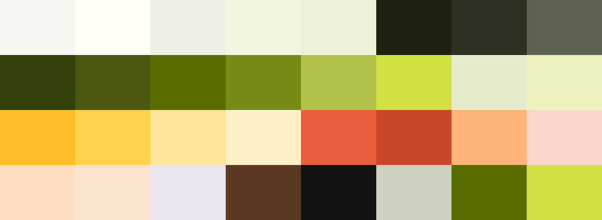

# Palette & type: Granola teardown → homecookd tokens v2

Source: live inspection of https://www.granola.ai/ on 2026-10-12 (built-in browser, 1024×768 viewport, computed styles + the site's own `--oats-*` CSS custom properties). Supersedes section 7.1 / 7.2 of `docs/lander-spec.md` where they differ.

**The headline finding: our olive `#5B6F00` and canvas `#F7F7F2` are literally Granola's `--oats-fill-accent` and `--oats-surface`.** Our lime `#B2C248` and highlighter yellow `#FEBE29` are also in Granola's system. So "use the Granola colors" means pushing further into what we already have. Granola keeps the greens and yellows small (buttons, footer panel, a gradient shimmer, halftone art), and that restraint is part of why it reads premium. We'll be bolder (whole sections in lime, sun & forest), since the founder asked for green + yellow.

---

## 1. Granola, as built

### Screenshots (this folder)
| File | What it shows |
|---|---|
| `granola-01-hero.jpg` | Canvas hero, 68 px serif H1, olive pill CTA, "New" chip in lime-tint, paper-white app window |
| `granola-02-for-the-doers.jpg` | One giant serif line (`min(12vw,160px)`) on white, then a `#292929` logo band |
| `granola-03-painted-card.jpg` | Product UI floating on an oil-painted landscape card (their signature imagery) |
| `granola-04-dark-testimonials.jpg` | `#292929` section, 60 px white serif H2, outlined quote cards |
| `granola-05-share-card.jpg` | Sharing UI over a painted mountain lake; lime/yellow initials avatars |
| `granola-06-pricing-collage.jpg` | Pricing card on a risograph/halftone collage in chartreuse + pink |
| `granola-07-footer-wordmark.jpg` | Giant `#292929` wordmark spanning the footer; lime `#B2C248` "footer-reveal-panel" under it |

### Palette (hex → role)
| Hex | Granola token / where | Role |
|---|---|---|
| `#F7F7F2` | `--oats-surface` | Canvas: app windows, cards, pricing sheet, input-disabled |
| `#FFFFFF` | `--oats-surface-raised/elevated`, body bg | Page sections & raised cards |
| `#F2F2EC` | `--oats-surface-sunken` | Sunken wells |
| `#EAEBE5` / `#D5D5D2` | `--oats-fill-soft-opaque` / hover, disabled | Chip fills, disabled |
| `rgba(98,90,34,.06)` / `rgba(86,81,46,.12)` | `--oats-fill-soft` / `-highlight-strong` | Ghost button fill: **an olive-brown tint, not grey**, which is why it feels warm |
| `rgba(71,67,42,.20)` | `--oats-border-hairline` | Hairlines (also olive-brown tinted) |
| `#292929` | `--oats-ink-primary`, `--oats-fill-primary` | Headings, body, black pill buttons, dark logo/testimonial sections |
| `#0E0F0C` | hero sub-copy, H2s | Deepest ink |
| `#4E4D4B` / `#72726E` / `#ACADA8` | ink secondary-strong / secondary / tertiary | Muted text ladder |
| `#FCFCF8` | `--oats-ink-primary-inverse` | Text on dark & on olive buttons |
| **`#5B6F00`** | `--oats-fill-accent`, `--oats-ink-accent-strong` | Primary CTA ("Download for free"), accent text |
| `#4C5616` | `--oats-fill-accent-hover` | CTA hover |
| `#788C15` | `--oats-ink-accent` | Accent text/icons |
| `#B2C248` | footer-reveal-panel, focus ring (`#b2c24899`) | Lime band + focus |
| `#D1E043` | gradient stop, halftone art | Chartreuse (brightest green) |
| `#E5EACD` / `#F2F6E1` | `--oats-surface-tint-accent` / `-accent-green` | Soft green tints ("New" chip) |
| `#434625` | misc | Dark olive |
| `#74BD00` | `--oats-system-dancing-bars` | Live "transcribing" bars |
| `#FEBE29` | gradient stop, avatar | Sun yellow |
| `#FFD24D` | avatar/illustration | Lemon |
| `#FF91E0` / `#CEBEF8` / `#D2E4F8` | gradient stops | Pink / lavender / sky, only in the rainbow text shimmer (`.hiw-grad`: grey → `#FEBE29` → `#FF91E0` → `#CEBEF8` → `#D2E4F8` → `#D1E043`) |
| `#E95D3D` / `#BD4A30` | `--oats-fill-danger` / `--oats-ink-danger` | Tomato (end-call, danger) |
| `#EAF4FE` / `#F3F0FA` | accent-blue / accent-purple surfaces | Rare cool tints |

### Fonts & type scale
- **Display: `quadrant`** (Grilli Type's Quadrant Text, a crisp editorial serif). **One weight (400) at every size**. No bold headlines anywhere. Size and tight leading do all the work.
- **Text: `melange`** (custom humanist grotesk, 300/400/500/600 + italic). Body 400, buttons 430 (variable in-between weight).
- Scale (desktop 1024 px): giant statement `min(12vw,160px)` (122.9 px at 1024), lh 1.0, tracking −0.015em · H1 68/63 px (−0.02em) · section H2 76.8/74.5 px (−0.02em) · pricing H2 88/86 px · testimonial H2 60/60 px · H2 48/48 px · H3 32/33.6 px (−0.01em) · H3 24/25.2 px · lead 20/28 · body 16/24 · small 14/18 (+0.01em) · caption 13/16 (+0.01em).
- Leading on display type is **< 1.0** (0.93–0.98). Tracking is negative on headings and slightly positive on small text.

### Radii, shadows, buttons
- Radii: pills everywhere (134 elements at `9999px`), then 4, 8, 12, 16, 24, **28 (big sheets, top-only `28px 28px 0 0`)**, 32, 64.
- Shadows: Tailwind-soft only (`0 4px 6px -1px / 0 20px 25px -5px` at 10% black). Plus a lovely **warm halo ring: `0 0 0 6–8px rgba(71,67,42,.05)`** around pills/cards.
- Buttons: pill, 16 px, weight 430, padding 9×24 px, olive fill + `#FCFCF8` text (primary), `#292929` fill (secondary), olive-brown 6% tint (ghost).

### Imagery & mood
Oil-painted landscapes (mountain lakes, cliffs, cedar forests) as the backdrop for product UI; a risograph/halftone collage of chartreuse + hot pink + numbers in the pricing band; hand-drawn single-line icons. **Mood words: oat-paper, calm, editorial, analog-warm, quiet-confident, unhurried, crafted, a little playful at the edges.**

---

## 2. homecookd tokens v2

Rules carried from the founder: canvas `#F7F7F2` + olive `#5B6F00` stay; lean into **green + yellow**; 1–2 warm accents; **brown & near-black only as accents/text**; dark sections are **deep green, never brown/black**.


*Row 1: canvas, surface, sunken, pistachio-wash, footer, ink, text, muted · Row 2: forest, green-deep, green, leaf, lime, chartreuse, sage, lime-wash · Row 3: sun, highlighter, lemon, butter, tomato, tomato-deep, apricot, blush · Row 4: apricot-soft, peach, ube, cocoa, black, ghost, (green, chartreuse repeated)*

### Roles
| Token | Hex | Use |
|---|---|---|
| **Neutrals** | | |
| `--canvas` | `#F7F7F2` | Page background (Granola surface) |
| `--surface` | `#FFFDF7` | Raised cards, phone-frame bezel inner, cream type on video |
| `--sunken` | `#EFEFE6` | Chips, inputs, quiet wells |
| `--pistachio-wash` | `#F2F6E1` | Alternate light section (Granola accent-green surface) |
| `--hairline` | `rgba(71,67,42,.14)` (≈ `#DEDDD2` on canvas) | Dividers, card borders (Granola's olive-brown hairline) |
| `--halo` | `rgba(71,67,42,.05)` | 6–8 px ring around pills/cards (Granola halo) |
| **Text** | | |
| `--ink` | `#1E2410` | Headlines; the "filled" state of scroll-scrub words. Green-tinted near-black, used **only as text** |
| `--text` | `#2D3222` | Body |
| `--muted` | `#5F6352` | Captions, `~estimates`, translations, meta |
| `--ghost` | `#CDD0BC` | Unfilled words in the a7 scroll-scrub (decorative, never final state) |
| `--cream` | `#FFFDF7` | Text on forest/green/video |
| `--muted-inverse` | `#C9D0AE` | Secondary text on forest |
| **Greens** | | |
| `--forest` | `#34430C` | **Dark sections** (statement band, final CTA), phone-in-hand stage if dark |
| `--forest-swirl` | `#3D4E10` | Tone-on-tone VERO swirl on forest |
| `--green-deep` | `#4C5A10` | Hover/pressed, text on sage |
| `--green` | `#5B6F00` | Primary buttons, links, play, progress, footer wordmark |
| `--leaf` | `#788C15` | Focus rings, outlined buttons, icons (≥3:1 UI) |
| `--lime` | `#B2C248` | Small marks, progress on dark, footer reveal strip |
| `--chartreuse` | `#D1E043` | **a7 marquee band**, hero CTA on video, emphasis words on forest |
| `--sage` | `#E6EBCF` | Soft tint: "Hear the cook" pill, recipe-card tint |
| `--lime-wash` | `#EDF2BE` | Recipe-card tint, chartreuse band's swirl |
| **Yellows** | | |
| `--sun` | `#FEBE29` | Saffron color block (VERO), sticker badges, avatar rings |
| `--sun-swirl` | `#FFCB4F` | Swirl on sun blocks |
| `--highlighter` | `#FFD24D` | Marker swipe behind key words (ink text on top) |
| `--lemon` | `#FFE59A` | Recipe-card tint |
| `--butter` | `#FFF1C7` | Butter section, active transcript line |
| **Warm accents** | | |
| `--tomato` | `#E95D3D` | Record dot, heart, a "family story" tag dot, one sticker. Ink text on it; cream only ≥24 px bold |
| `--tomato-deep` | `#C8462A` | Only if a tomato button is ever needed (cream text) |
| `--tomato-ink` | `#A8361B` | Text on blush |
| `--apricot` | `#FFB677` | Stickers, mascot cheeks, illustration fills |
| `--blush` | `#FAD6CB` | Tomato tint (recipe card, "story" tag bg) |
| **Accent-only (never a section color)** | | |
| `--cocoa` | `#5A3A22` | Caveat handwritten notes, pot-mascot outline, tiny doodles |
| `--black` | `#121410` | One black pill per screen max (e.g. nav "Get the app"), phone bezel |

### Recipe-card tints (a7 floating cards → recipe cards)
Each card is `bg / title ink / chip`, with a photo inset. Mix 2–3 bold cards among light ones, the way a7 does.
| # | Name | Background | Title & text | Example card |
|---|---|---|---|---|
| 1 | Sage | `#E6EBCF` | `#3C4A0B` | Grandpa's chimichurri |
| 2 | Lime-wash | `#EDF2BE` | `#3C4A0B` | Dad's green curry |
| 3 | Butter | `#FFF1C7` | `#1E2410` | Grandma's cornbread |
| 4 | Lemon | `#FFE59A` | `#1E2410` | Mom's lemon rice |
| 5 | Apricot-soft | `#FFDDBF` | `#8A3F12` | Nana's apricot jam |
| 6 | Peach | `#F9E3CF` | `#6E4A33` | Lola's adobo |
| 7 | Blush | `#FAD6CB` | `#A8361B` | Abuela's pozole rojo |
| 8 | Ube | `#ECE6F2` | `#3F3558` | Halmeoni's ube halaya (the one cool note) |
| 9 | **Green** (bold) | `#5B6F00` | `#FFFDF7` | Dad's Sunday chili |
| 10 | **Forest** (bold) | `#34430C` | `#D1E043` / `#FFFDF7` | Grandma's red-braised pork belly |
| 11 | **Sun** (bold) | `#FEBE29` | `#1E2410` | Mom's Sunday pancakes |
| 12 | **Chartreuse** (bold) | `#D1E043` | `#34430C` | Auntie's herb salad |

### Section colors (page rhythm)
- Most sections: `--canvas`; one alternate in `--pistachio-wash` or `--butter`.
- **Dark section: `--forest #34430C`** (cream text, chartreuse/sun emphasis, `--forest-swirl` pattern). Never `#292929`, never brown.
- **Bold blocks**: `--chartreuse` marquee band (a7), `--sun` saffron block (VERO). At most one bold block every 2–3 sections.
- **Phone-in-hand features (a8)**: ONE background across the whole section: `--canvas` or `--pistachio-wash`, no split.
- **Footer: `--footer-bg #F1F2DC`** (pale pistachio-cream), giant lowercase wordmark in `--green #5B6F00` (the a3 stroke-grow animation strokes in `#F1F2DC`), a final 12–16 px `--chartreuse` strip at the very bottom (nod to Granola's lime footer-reveal panel). Small footer text `--ink`/`--muted`.
- **Hero video scrim**: `linear-gradient` from `rgba(30,36,16,.70)` (behind body copy) / `.55` (behind a ≥48 px headline only) to transparent. Green-tinted ink, not black. Hero CTA: `--chartreuse` with `--ink` text (10.99:1); secondary: cream outline.

### CSS custom properties
```css
:root {
  /* neutrals */
  --canvas: #F7F7F2;
  --surface: #FFFDF7;
  --sunken: #EFEFE6;
  --pistachio-wash: #F2F6E1;
  --footer-bg: #F1F2DC;
  --hairline: rgba(71, 67, 42, 0.14);
  --halo: rgba(71, 67, 42, 0.05);

  /* text */
  --ink: #1E2410;
  --text: #2D3222;
  --muted: #5F6352;
  --ghost: #CDD0BC;
  --cream: #FFFDF7;
  --muted-inverse: #C9D0AE;

  /* greens */
  --forest: #34430C;
  --forest-swirl: #3D4E10;
  --green-deep: #4C5A10;
  --green: #5B6F00;
  --leaf: #788C15;
  --lime: #B2C248;
  --chartreuse: #D1E043;
  --sage: #E6EBCF;
  --lime-wash: #EDF2BE;
  --olive-ink: #3C4A0B;           /* text on sage / lime-wash */

  /* yellows */
  --sun: #FEBE29;
  --sun-swirl: #FFCB4F;
  --highlighter: #FFD24D;
  --lemon: #FFE59A;
  --butter: #FFF1C7;

  /* warm accents */
  --tomato: #E95D3D;
  --tomato-deep: #C8462A;
  --tomato-ink: #A8361B;
  --apricot: #FFB677;
  --apricot-soft: #FFDDBF;
  --apricot-ink: #8A3F12;
  --peach: #F9E3CF;
  --peach-ink: #6E4A33;
  --blush: #FAD6CB;
  --ube: #ECE6F2;
  --ube-ink: #3F3558;

  /* accent-only */
  --cocoa: #5A3A22;
  --black: #121410;

  /* semantic */
  --btn-primary-bg: var(--green);       --btn-primary-fg: var(--cream);
  --btn-primary-hover: var(--green-deep);
  --btn-hero-bg: var(--chartreuse);     --btn-hero-fg: var(--ink);
  --btn-soft-bg: var(--sage);           --btn-soft-fg: var(--green-deep);
  --focus-ring: var(--leaf);
  --scrim-strong: rgba(30, 36, 16, 0.70);
  --scrim-soft: rgba(30, 36, 16, 0.55);

  /* radii (Granola + app) */
  --r-pill: 999px;
  --r-sm: 12px;
  --r-md: 16px;
  --r-card: 24px;     /* recipe cards */
  --r-media: 28px;    /* big photo/video cards; section sheet top corners */
  --r-sheet: 40px;    /* section that slides over the pinned hero (a4) */

  /* shadows: soft only */
  --shadow-card: 0 1px 2px rgba(30, 36, 16, 0.04), 0 12px 32px -12px rgba(30, 36, 16, 0.18);
  --shadow-float: 0 2px 6px rgba(30, 36, 16, 0.05), 0 28px 60px -20px rgba(30, 36, 16, 0.28);
  --ring-halo: 0 0 0 8px var(--halo);

  /* type (see section 4) */
  --font-display: 'Fraunces', 'Iowan Old Style', Georgia, serif;
  --font-text: 'DM Sans', system-ui, -apple-system, 'Segoe UI', sans-serif;
  --font-hand: 'Caveat', 'Bradley Hand', cursive;
}
```
The lander is light-only (like the app mockups). If a dark scheme is ever added, base it on `--forest`, not black.

---

## 3. Contrast check (WCAG 2.1, sRGB relative luminance)
Script: `contrast.py`, pairs: `contrast-pairs.txt` (run `python3 contrast.py < contrast-pairs.txt`). AA = 4.5 body, 3.0 large (≥24 px, or ≥18.66 px bold) & UI.

| Result | Ratio | Foreground / background | Use |
|---|---|---|---|
| PASS | 14.86 | ink `#1E2410` / canvas | headlines |
| PASS | 12.28 | text `#2D3222` / canvas | body |
| PASS | 5.76 | muted `#5F6352` / canvas | captions |
| PASS | 5.26 | green `#5B6F00` / canvas | links, green text |
| PASS (large/UI) | 3.51 | leaf `#788C15` / canvas | focus rings, icons, ≥24 px only |
| PASS | 9.47 | cocoa `#5A3A22` / canvas | Caveat notes |
| PASS | 15.70 / 12.98 / 6.08 / 5.55 | ink / text / muted / green on surface `#FFFDF7` | cards |
| PASS | 11.41 / 5.35 / 4.88 | text / muted / green on sunken `#EFEFE6` | chips |
| PASS | 14.48 / 5.61 / 5.12 | ink / muted / green on pistachio-wash | alt section |
| PASS | 7.88 / 6.17 / 4.61 / 5.05 | olive-ink / green-deep / green / muted on sage | Hear-the-cook pill, cards |
| PASS | 14.19 / 5.50 / 9.04 | ink / muted / cocoa on butter | butter section |
| PASS | 11.09 | ink / highlighter `#FFD24D` | marker words |
| PASS | 9.59 / 6.45 / 6.11 | ink / forest / cocoa on sun `#FEBE29` | saffron block, stickers |
| PASS | 10.99 / 7.40 | ink / forest on chartreuse `#D1E043` | marquee band, hero CTA |
| PASS | 8.14 / 5.48 | ink / forest on lime `#B2C248` | lime marks |
| PASS | 5.55 | cream / green | primary button |
| PASS (large only) | 3.89 | chartreuse / green | big display words only |
| PASS | 7.43 / 5.20 | cream / chartreuse on green-deep | |
| PASS | 10.56 / 7.40 / 6.45 / 5.48 / 6.71 | cream / chartreuse / sun / lime / muted-inverse on forest `#34430C` | dark sections |
| PASS | 4.64 | ink / tomato `#E95D3D` | sticker text |
| PASS (large only) | 3.39 | cream / tomato | ≥24 px bold only |
| PASS | 4.73 | cream / tomato-deep `#C8462A` | tomato button |
| PASS | 9.28 | ink / apricot `#FFB677` | stickers |
| PASS | 4.85 | tomato-ink / blush | story tag, card |
| PASS | 8.29 / 12.87 / 5.84 / 6.29 / 9.22 | card inks on lime-wash / lemon / apricot-soft / peach / ube | recipe cards |
| PASS | 4.97 / 14.05 / 5.44 | green / ink / muted on footer `#F1F2DC` | footer |
| PASS | 17.24 | canvas / black pill | the one black button |
| PASS (large) | 3.61 | cream / worst-case white pixel under 55% scrim | hero headline ≥48 px |
| PASS | 4.92 / 6.00 | cream / worst-case white pixel under 65% / 70% scrim | hero body text → use 70% |
| FAIL (expected) | 1.02 | cream / white video highlight, no scrim | why the scrim is mandatory |
| decorative | 1.46 | ghost / canvas | unfilled scrub words only; reduced-motion shows filled ink |

Don'ts: no `--muted` on green/forest; no green text on sun/tomato; no `--leaf` or `--lime` for body text on light backgrounds; no cream on chartreuse/lime/sun/highlighter.

---

## 4. Typography

### Recommendation
- **Display: Fraunces** (Google Fonts, variable: `wght` 100–900, `opsz` 9–144, `SOFT` 0–100, `WONK` 0–1). Set **`SOFT` 100, `WONK` 0** for roman, **`WONK` 1** for italics, `font-optical-sizing: auto`.
- **Text: DM Sans** (variable: `wght` 100–1000, `opsz` 9–40). The app's body font, so the lander and the app feel like one product.
- **Handwritten: Caveat 600** (variable 400–700) for margin notes only, in `--cocoa` or `--green`.

### Why (against the references)
- **Granola** uses exactly this structure: one serif display at a single calm weight, very large and tightly leaded, over a clean humanist sans. Quadrant isn't free; Fraunces at `opsz` 144, weight 450–500 gives the same calm editorial serif look.
- **VERO** (loved): a chunky, round, soft serif with bold italics. Fraunces at `SOFT` 100, weight 650–720 is the closest free match to Recoleta, and its italic (`WONK` 1) brings VERO's "*BUNCH*" warmth.
- **The app** titles are in Newsreader (serif). A soft serif keeps the lander in the same family; DM Sans is the app's own body font.
- **a7** (#1 favorite) gets its clean look from **scale, centering, air and medium weight**, more than from the typeface itself. We copy that by keeping scroll-scrub statements at Fraunces **500**, not 700, by setting a7-style UI bits (chips, tags, labels, nav, buttons, card meta) in DM Sans 500–600 with tight tracking, and by keeping lines to 2–4 words, centered.
- **Audience (incl. a 58-year-old on a phone)**: Fraunces has big open counters and DM Sans has a large x-height; body never below 17 px; Caveat never carries essential info.
- If the team wants it even closer to a7, swap the scroll-scrub statements (only) to DM Sans 600 at `opsz` 40, tracking −0.035em. Keep Fraunces for the hero, the cook's words, recipe titles & the wordmark.

### Which text uses which font
| Element | Font & settings | Size (mobile → desktop) | Leading / tracking |
|---|---|---|---|
| Hero H1 ("Cook it like *Grandma* does.") | Fraunces 680, SOFT 100; the rotating relation word in **Fraunces Italic 620, WONK 1** on `--highlighter` | `clamp(3.5rem, 1.6rem + 8vw, 10.5rem)` 56 → 168 px | 0.92 / −0.035em |
| a7 scroll-scrub statements (gray → ink word fill, inline photos) | Fraunces **500**, SOFT 100 (inline italic 500 for one phrase) | `clamp(2.75rem, 1.2rem + 6.4vw, 7.5rem)` 44 → 120 px | 0.98 / −0.03em |
| Section H2 | Fraunces 560, SOFT 100 | `clamp(2.25rem, 1.4rem + 3.6vw, 4.75rem)` 36 → 76 px | 1.0 / −0.025em |
| VERO color-block statements (forest/sun) | Fraunces 700 + Italic 500 mixed in one line | same as H2 or larger | 1.0 / −0.03em |
| H3 / feature titles beside the phone (a8) | Fraunces 600, SOFT 100 | `clamp(1.5rem, 1.2rem + 1.2vw, 2rem)` 24 → 32 px | 1.1 / −0.015em |
| Recipe-card titles | Fraunces 600, SOFT 100 | 22 → 26 px | 1.12 / −0.01em |
| The cook's quoted words ("a handful, you'll know") | Fraunces Italic 450, WONK 1 | 20 → 28 px | 1.3 / 0 |
| Lead paragraph | DM Sans 400, opsz auto | `clamp(1.25rem, 1.1rem + .6vw, 1.5rem)` 20 → 24 px | 1.4 / −0.005em |
| Body | DM Sans 400 | `clamp(1.0625rem, 1rem + .25vw, 1.1875rem)` 17 → 19 px | 1.55 / 0 |
| Buttons | DM Sans 600 | 17 → 18 px, min height 52 px (hero 60 px) | 1 / 0.005em |
| Nav, chips, tags, card meta ("by Grandma · 45 min") | DM Sans 500 | 16 px (never below) | 1.3 / 0.005em |
| Eyebrow labels | DM Sans 600, uppercase | 15 px | 1.2 / 0.08em |
| Handwritten notes ("first try in the dorm", "~1½ cups") | Caveat 600, `--cocoa` or `--green` | 22 → 28 px | 1.1 / 0 |
| Footer wordmark "homecookd" | Fraunces 800, SOFT 100, lowercase, `--green` | ~24vw | 0.8 / −0.04em |

Never use Fraunces below 20 px or DM Sans for display headlines (except the optional a7 swap above). Max one italic phrase per headline.

### next/font setup
```ts
// web/app/fonts.ts
import { Fraunces, DM_Sans, Caveat } from 'next/font/google';

export const display = Fraunces({
  subsets: ['latin', 'latin-ext'],
  style: ['normal', 'italic'],
  axes: ['SOFT', 'WONK', 'opsz'], // weight omitted => full variable wght range
  variable: '--font-display',
  display: 'swap',
});
export const text = DM_Sans({
  subsets: ['latin', 'latin-ext'],
  style: ['normal', 'italic'],
  axes: ['opsz'],
  variable: '--font-text',
  display: 'swap',
});
export const hand = Caveat({
  subsets: ['latin'],
  weight: ['600'],
  variable: '--font-hand',
  display: 'swap',
});
```
```css
.display { font-family: var(--font-display); font-variation-settings: 'SOFT' 100, 'WONK' 0; font-optical-sizing: auto; }
.display em, .display i { font-variation-settings: 'SOFT' 100, 'WONK' 1; }
```
Translation examples in other scripts (Hindi, Chinese, Arabic, Korean) fall outside Fraunces/DM Sans. Load only the needed Noto families for those few lines (e.g. `Noto_Serif_Devanagari`, `Noto_Serif_SC`, `Noto_Naskh_Arabic`, `Noto_Serif_KR`) with `display: 'swap'` and `preload: false`. Spanish, Tagalog and Vietnamese are covered by `latin-ext` (Fraunces also ships a `vietnamese` subset).
